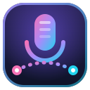

<div align="center">



# MicBridge

**Use o celular como microfone do PC, com áudio tratado em tempo real.**


</div>

---

## ✨ O que é

O MicBridge transforma o celular em um microfone sem fio para o PC, **só na rede local**.
Você abre uma página no celular (via QR code), o áudio viaja por **WebRTC** com baixa latência
e o app em Rust trata o som antes de entregá-lo a um microfone virtual do PipeWire, que você
seleciona no Discord, OBS, Meet etc.

## 🎛️ Recursos

- 📱 **Celular como microfone** pela página web, sem instalar app no celular
- ⚡ **Baixa latência** com WebRTC (Opus sobre UDP, sem STUN, apenas LAN)
- 🎚️ **Perfis de voz de um clique**: Natural, Chamada, Podcast, Streaming ou Original (sem tratamento); o app lembra o último escolhido
- 🔇 **Cancelamento de ruído** com RNNoise e **filtro de graves** contra zumbido e vibração de mesa
- 🚪 **Noise gate** com hold e limiar ajustável
- 🗣️ **De-esser** (suaviza chiados) e **realce de clareza** da voz
- 🗜️ **Compressor** (limiar, razão), **volume automático** e limitador de pico
- 📊 **Medidores** de entrada e saída em tempo real
- 🔳 **QR code** para conectar rapidamente
- 🖥️ **Interface GTK4 + libadwaita** nativa do GNOME
- 🔔 **Ícone na bandeja** com bolinha de status no padrão do Discord: 🟢 conectado (com anel pulsando quando há voz), 🟡 conectando/reconectando e 🔴 erro (piscando), ⚪ desconectado; fechar a janela só a esconde
- 🚀 **Servidor HTTPS embutido**: sobe com o app e para quando ele fecha, sem Ruby nem dependências extras
- 🔁 **Reconexão automática**: Wi-Fi caiu ou tela bloqueou? O celular volta sozinho, sem novo QR
- 💾 **Pareamento persistente**: QR só na primeira vez; depois o celular é reconhecido
- 🚦 **Estado sempre visível**: conectado, desconectado, reconectando ou erro (janela e bandeja)
- 🩹 **PipeWire autorrecuperável**: se o microfone virtual sumir, é recriado sem reiniciar nada
- 🏷️ **Nome fixo `micbridge.local`** via mDNS (avahi): o endereço não muda mesmo que o IP mude
- 🔐 **Pareamento seguro**: token no QR code, janela de pareamento temporária e um celular por vez
- 🔏 **TLS com CA local**: certificado gerado pelo próprio app e impressão digital visível na janela

## 🧭 Como funciona

```
 Celular (página HTTPS + WebRTC)
        │  SDP offer  (POST /offer)
        ▼
 App Rust (GTK4 / libadwaita, servidor axum + rustls)
        ▲                              │
        └── áudio Opus via WebRTC ─────┤  decode
              (UDP, LAN)               ▼
        graves ▶ RNNoise ▶ gate ▶ de-esser ▶ clareza ▶ compressor ▶ volume auto ▶ limitador
                                       │
                                       ▼ pw-cat
                              sink  vdo_input
                                       │
                                       ▼
                           🎤 fonte  "Microfone_VDO"
```

| Pasta | Conteúdo |
|-------|----------|
| `app/` | App Rust: UI, servidor HTTPS (axum), certificados (rcgen), WebRTC (`webrtc` 0.21), DSP, bandeja |
| `app/web/` | Página do celular (HTML, JS e CSS), embutida no binário |
| `scripts/` | `install.sh` (instala/reinstala app + atalho) e `uninstall.sh` |

## 📋 Requisitos

- Linux com **PipeWire** (`pw-cat`, `pw-loopback`)
- **Rust** (edição 2024), **GTK 4**, **libadwaita**, **libopus**
- `librsvg` (`rsvg-convert`) para gerar os ícones na instalação
- **avahi** (opcional, recomendado) para o nome fixo `micbridge.local`: `sudo systemctl enable --now avahi-daemon`
- GNOME: extensão **AppIndicator** para o ícone da bandeja

## 🚀 Instalação

```sh
git clone git@github.com:Wpaif/MicBridge.git
cd MicBridge
./scripts/install.sh
```

Isso compila o app e instala binário, ícones e o atalho no menu de aplicativos.
Procure por **MicBridge**.

| Comando | Efeito |
|---------|--------|
| `./scripts/install.sh` | Instala ou atualiza por cima, mantendo pareamento e certificados |
| `./scripts/install.sh --reinstall` | Instalação limpa (apaga o pareamento e o build; **mantém a CA**) |
| `./scripts/install.sh --reinstall --new-ca` | Idem, gerando também uma CA nova |
| `./scripts/uninstall.sh` | Remove app, atalho, ícones e autostart; preserva pareamento e certificados |
| `./scripts/uninstall.sh --purge` | Remove também pareamento e certificados (`--keep-ca` preserva a CA) |

## ▶️ Uso

**Primeira vez**
1. Abra o **MicBridge**: o microfone virtual e o servidor sobem sozinhos e o QR code já aparece.
   Instale a CA no celular uma vez (veja *Segurança*) para o navegador não mostrar avisos.
2. No celular (mesma rede), escaneie o QR e toque em **Iniciar microfone**. Pronto.
3. No Discord/OBS, escolha **Microfone_VDO** como entrada.
4. Na janela do app, escolha um **Perfil de voz** (Chamada é o padrão). Os controles individuais
   ficam em **Ajustes avançados**.

**Depois**
Abra o MicBridge (ou ative **Iniciar com o sistema** para ele subir escondido na bandeja) e abra
a página no celular: ele é reconhecido e o áudio volta sozinho. Dica: adicione a página à tela
inicial do celular.

O estado aparece no topo da janela e no ícone da bandeja: **Conectado**, **Reconectando**
(a conexão caiu; o celular tenta voltar sozinho), **Desconectado** ou **Erro**.

**Nome fixo (mDNS):** com o `avahi-daemon` ativo, o app anuncia `micbridge.local` e o QR passa a
usar `https://micbridge.local:3443`. O cookie de pareamento é por endereço, então com o nome fixo
ele continua valendo mesmo que o IP do PC mude por DHCP. Sem o avahi, o app usa o IP (a janela
indica qual dos dois está em uso) e uma mudança de IP exige parear de novo; nesse caso, reserve o
IP no roteador.

> Limitações: navegadores móveis podem suspender o microfone com a tela bloqueada (a página mantém
> a tela acesa com Wake Lock enquanto transmite); alguns Androids antigos não resolvem `.local`
> (use o IP); o servidor escuta no IP de quando subiu, então reabra o app se o IP mudar.

Para encerrar de verdade, use **Sair** no menu da bandeja. O botão "X" apenas esconde a janela.

### Desenvolvimento

```sh
cd app && cargo run --release   # app (o servidor HTTPS já vem embutido)
cargo test                      # testes do DSP
```

Pareamento e certificados ficam em `~/.local/share/micbridge` (respeita `XDG_DATA_HOME`).

## 🛠️ Ajustes de áudio

Escolha um **Perfil de voz** e pronto. Para refinar, abra **Ajustes avançados**:

| Controle | Efeito |
|----------|--------|
| Cancelamento de ruído | Remove ruído de fundo (RNNoise) |
| Filtro de graves | Corta zumbido e vibração abaixo de ~80 Hz |
| Noise gate / limiar | Atenua abaixo do nível definido |
| Suavizar chiados | De-esser: reduz "s" e "ch" agressivos |
| Realçar clareza da voz | Reforço suave perto de 3 kHz |
| Compressor / limiar / razão | Nivela a dinâmica da voz |
| Volume automático | Mantém o nível constante e congela nas pausas; dispensa o ganho manual |
| Ganho manual | Só vale com o volume automático desligado; passa por um limitador de pico |

## 🔒 Segurança

- **Pareamento por token:** a cada abertura o app gera um token aleatório (128 bits) embutido
  no QR code, aceito só com a janela de pareamento aberta. Ao parear, o app entrega ao celular um
  id e um segredo de longa duração (256 bits) guardados num cookie (`Secure`, `HttpOnly`,
  `SameSite=Strict`, 1 ano). O token do QR muda a cada execução, mas o celular já pareado
  continua reconhecido: não precisa escanear de novo.
- **Um celular por vez:** enquanto um dispositivo estiver conectado, outro recebe 409. O mesmo
  celular pode reconectar (recarregar a página) e assume a própria conexão.
- **Janela de pareamento:** novos celulares só entram enquanto a opção **Aceitar novo celular**
  estiver ativa. Ela abre por 5 min só quando não há nenhum celular pareado (primeira utilização) e
  fecha sozinha após cada pareamento. As credenciais de cada celular ficam em disco só como hash
  (`~/.local/share/micbridge/devices.json`, modo 600); **Esquecer todos** revoga tudo.
  Com ela fechada, um QR vazado não serve; só celulares já pareados reconectam.
- **TLS com CA local:** o app cria a *MicBridge Local CA* (em `~/.local/share/micbridge/certs`) e
  assina o certificado do servidor com ela. Baixe a CA no celular em `https://<IP>:3443/ca.crt`,
  instale-a como certificado de CA e confie nela uma vez: o navegador passa a aceitar sem avisos, o
  que protege contra alguém se passando pelo servidor. A chave da CA nunca sai do PC e a CA é
  preservada em reinstalações. O certificado do servidor é refeito sozinho quando o IP muda. Sem instalar a CA, confira a **impressão digital SHA-256** mostrada no
  app com a do aviso do navegador.
- **Superfície de rede:** o servidor HTTPS escuta só na interface da LAN e no loopback (não em
  `0.0.0.0`). Respostas levam CSP restrita, `no-store` e `nosniff`.
- **Camada de rede (fora do app):** para isolamento forte, use uma VLAN/rede de convidados
  separada, regra de firewall liberando a porta 3443 só para o IP do celular, ou uma VPN
  (ex.: Tailscale).

## 📄 Licença

Projeto pessoal, sem licença definida.

## Teste de voz e comparação A/B

No painel **Teste de voz**, toque em **Gravar teste**, fale e depois em **Parar gravação**.
A captura termina automaticamente após 30 segundos de áudio recebido. Você pode ouvir
**Original** (PCM recebido antes dos efeitos locais) e **Tratado** (resultado do DSP).
A reprodução usa a saída padrão do sistema; use fones para evitar realimentação.
Iniciar outro teste encerra a reprodução e substitui o anterior. Uma desconexão finaliza
o trecho capturado: reconectar não continua a gravação antiga.

**Exportar WAVs** permite escolher um destino e grava dois arquivos mono a 48 kHz,
PCM de 16 bits: o original e um arquivo com sufixo `-tratado.wav`. O aplicativo pede
confirmação antes de substituir arquivos existentes. Cancelar não grava nada. Falhas
informam se apenas um dos arquivos foi concluído. Nenhum teste é salvo automaticamente.

O RNNoise introduz atraso interno; as versões preservam as posições de captura antes e
depois do DSP, sem compensar esse atraso. O teste serve para comparar timbre, volume e
cortes, e não para medir a latência total entre celular e saída. Se a fila de captura
lotar, a gravação termina como **Teste incompleto**, preservando o trecho disponível;
o áudio ao vivo continua sem esperar pelo gravador.
