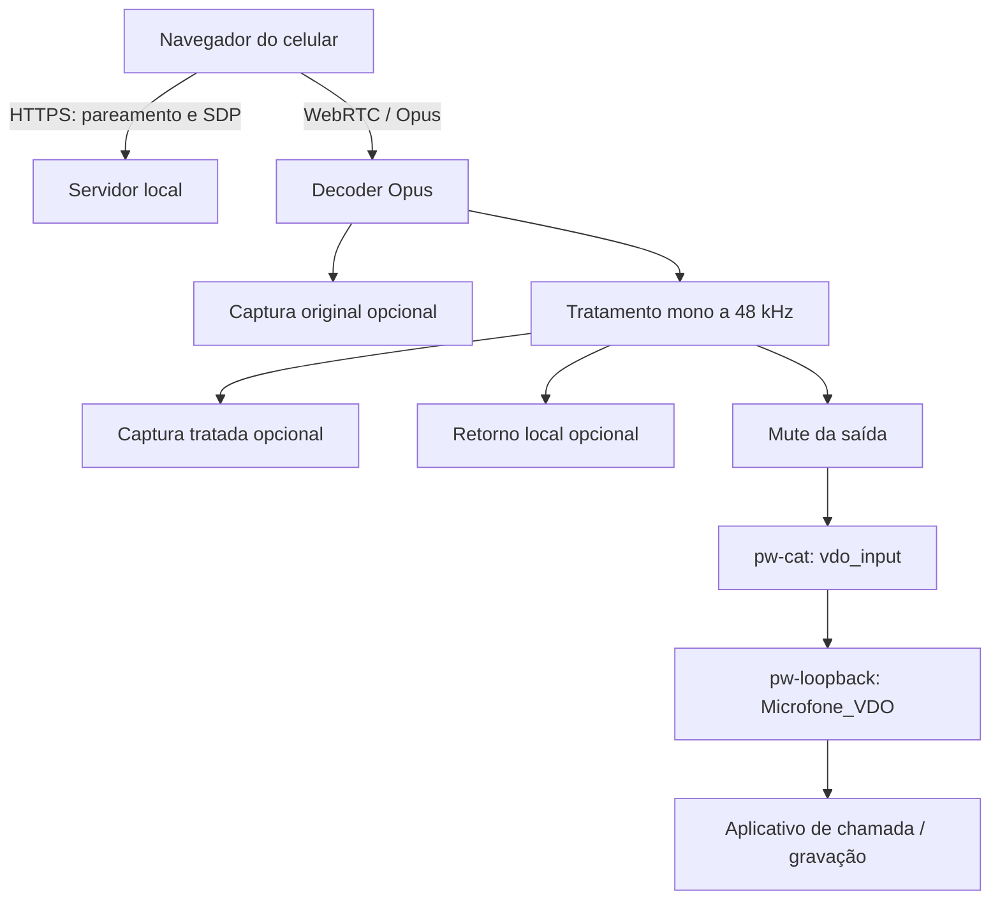

# Arquitetura

## Caminho do áudio

O processamento ocorre antes do mute e da escrita no microfone virtual. Captura
A/B e retorno recebem o áudio antes do mute. O retorno usa uma saída selecionada
e volume próprio; não é reprodução no celular.

A cadeia DSP é: passa-altas → RNNoise → gate → de-esser → presença → compressor
→ ganho automático → ganho manual → limitador. O RNNoise usa frames de 480 amostras
(10 ms a 48 kHz); o decoder aceita pacotes Opus de até 120 ms. A comparação A/B
preserva os pontos de captura, sem compensar o atraso interno do denoiser.

## Módulos

| Responsabilidade | Arquivos |
|---|---|
| Aplicação, runtime e montagem da interface | [main.rs](../app/src/main.rs) |
| Estado da sessão e pareamento | [state.rs](../app/src/state.rs) |
| HTTPS, WebRTC e emissão de áudio | [server.rs](../app/src/server.rs) |
| Página do celular e autenticação web | [web.rs](../app/src/web.rs), [app/web](../app/web/) |
| Certificados locais | [tls.rs](../app/src/tls.rs) |
| Processamento e métricas dos efeitos | [dsp.rs](../app/src/dsp.rs), [dsp/effects.rs](../app/src/dsp/effects.rs) |
| Microfone virtual, mDNS e recuperação da saída | [output.rs](../app/src/output.rs) |
| Captura, WAV e reprodução A/B | [recording.rs](../app/src/recording.rs), [recording](../app/src/recording/) |
| Coordenação de reprodução e retorno | [local_audio.rs](../app/src/local_audio.rs) |
| Retorno, dispositivo, fila e volume | [monitor.rs](../app/src/monitor.rs), [monitor](../app/src/monitor/) |
| Exclusividade e restauração dos links | [monitor/routing](../app/src/monitor/routing/) |
| Perfis personalizados e preferências | [profiles.rs](../app/src/profiles.rs), [settings.rs](../app/src/settings.rs) |
| Tema, paletas e diálogo de aparência | [theme.rs](../app/src/theme.rs), [theme_ui.rs](../app/src/theme_ui.rs) |
| Colunas, lateral fixa e widgets compartilhados | [studio_layout.rs](../app/src/studio_layout.rs), [connection_sidebar.rs](../app/src/connection_sidebar.rs), [widgets.rs](../app/src/widgets.rs) |
| Bandeja e ícone | [tray.rs](../app/src/tray.rs), [tray_icon.rs](../app/src/tray_icon.rs) |

Os arquivos `*_ui.rs` apresentam os modelos e coordenadores na interface. Estado
de transição de áudio não é confirmado apenas pelo clique: a interface aguarda
a conclusão das operações correspondentes.

## Concorrência e recuperação

O runtime Tokio executa rede e processos de áudio; GTK apresenta a interface no
thread principal. Parâmetros DSP e leituras rápidas usam atômicos. Gravação e
retorno recebem cópias por filas limitadas: falha/atraso desses consumidores pode
interromper o recurso local sem obrigar o produtor a esperar por ele.

O retorno exclusivo identifica nodes/portas do PipeWire e registra links antes
de removê-los. A restauração verifica a identidade atual dos objetos. Um lock
impede duas instâncias de controlar o mesmo registro de roteamento. A/B e retorno
são mutuamente exclusivos; gravação pode coexistir com retorno.

## Arquivos do aplicativo

| Arquivo ou diretório | Uso |
|---|---|
| `$XDG_DATA_HOME/micbridge/settings.json` | Perfis de áudio, seleção e aparência; chaves não relacionadas são preservadas ao atualizar. |
| `$XDG_DATA_HOME/micbridge/devices.json` | Dispositivos pareados e hashes dos segredos. |
| `$XDG_DATA_HOME/micbridge/monitor-routing.json` | Links pendentes de restauração do retorno. |
| `$XDG_DATA_HOME/micbridge/monitor-routing.lock` | Lock do registro de roteamento. |
| `$XDG_DATA_HOME/micbridge/certs/` | CA, chaves, certificado do servidor, IP e impressão digital. |
| `~/.config/autostart/dev.wilian.MicBridge.desktop` | Autostart gravado pelo aplicativo. |
| `$XDG_STATE_HOME/omarchy/current/theme/colors.toml` | Paleta Omarchy atual, somente leitura. |
| `$XDG_CONFIG_HOME/omarchy/current/theme/colors.toml` | Caminho legado da paleta, somente leitura. |

Padrões XDG: dados em `~/.local/share`, estado em `~/.local/state` e configuração
em `~/.config`. O autostart do app usa diretamente `~/.config`; o desinstalador
consulta `XDG_CONFIG_HOME`. Considere essa diferença ao usar caminhos personalizados.

Dados de execução não pertencem ao repositório. A estrutura dos arquivos de
desenvolvimento está em [Desenvolvimento](development.md#arquivos-ocultos-e-locais).
